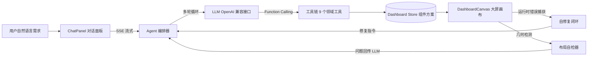

# NL2Dashboard

**用自然语言生成数据大屏 —— 基于 LLM Function Calling 的 AI 大屏生成器**

输入一句需求（如「生成一个电商双十一实时销售大屏」），AI 自动完成布局规划 → 组件生成 → 数据接入 → 布局自检 → 自动修复，几秒钟产出一张完整可用的数据大屏。

> A clean-room, standalone implementation of "NL2Dashboard": natural language to data dashboard, powered by LLM function calling, multi-turn agent orchestration, layout self-check and AI self-repair.

## ✨ 核心特性

- **NL2Dashboard 完整链路**：自然语言 → 布局规划 → 组件批量生成 → 数据校验 → 落库，把人工搭建大屏压缩到秒级
- **Function Calling 工具链**：9 个领域工具（规划/图表/KPI/表格/文本/更新/删除/检查/完成），大模型以多轮 Agent 方式编排调用
- **流式体验（SSE）**：生成过程实时流式展示思考内容与任务步骤，每一步工具调用可见
- **AI 布局自检**：内置组件重叠与越界的几何检测算法（支持 %/px 混合坐标解析），以数据驱动方式替代截图视觉方案，AI 可自主发现并修正布局问题
- **AI 自修复闭环**：组件渲染错误自动捕获 → 错误上下文提取 → AI 定位修复 → 热更新重渲染
- **拖拽编辑**：画布组件可拖拽移动、右下角缩放，AI 生成后可继续人工微调
- **多模型兼容**：任何 OpenAI 兼容接口均可接入（DeepSeek / 通义千问 / Kimi / OpenAI / 本地 Ollama 等），API Key 仅存本地浏览器

## 🏗 架构



## 🚀 快速开始

```bash
npm install
npm run dev
```

1. 点击右上角「设置」，填入任意 OpenAI 兼容接口的 Base URL、API Key、模型名（默认 DeepSeek）
2. 在左侧输入需求，例如：`生成一个新能源汽车销售数据大屏`
3. 观看 AI 规划布局、逐个生成组件、自检并修复布局问题

## 📦 技术栈

Vue 3 + TypeScript + Vite + Pinia + ECharts，零后端（数据由确定性模拟器生成，可复现）。

## 🗺 Roadmap

- [ ] 组件代码在线编译与模块沙箱（动态组件运行时）
- [ ] 真实数据源接入（REST API / WebSocket）
- [ ] RAG：基于企业私有数据的数据问答与生成约束
- [ ] 方案导入导出与分享
- [ ] 主题市场与更多物料

## 📄 License

[MIT](./LICENSE)
