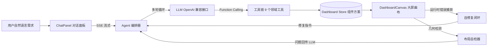

# NL2Dashboard

**用自然语言生成数据大屏 —— 基于 LLM Function Calling 的 AI 大屏生成器**

输入一句需求（如「生成一个电商双十一实时销售大屏」），AI 自动完成布局规划 → 组件生成 → 数据接入 → 布局自检 → 自动修复，几秒钟产出一张完整可用的数据大屏。

> A clean-room, standalone implementation of "NL2Dashboard": natural language to data dashboard, powered by LLM function calling, multi-turn agent orchestration, layout self-check and AI self-repair.

## ✨ 核心特性

- **NL2Dashboard 完整链路**：自然语言 → 布局规划 → 组件批量生成 → 数据校验 → 落库，把人工搭建大屏压缩到秒级
- **Function Calling 工具链**：10 个领域工具（规划/图表/KPI/表格/文本/自定义组件/更新/删除/检查/完成），大模型以多轮 Agent 方式编排调用
- **对话式增量编辑**：大屏生成后可持续对话修改（「把饼图换成柱状图」「再加一行 KPI」），AI 基于现有画布状态做增量更新，而非推倒重来
- **AI 自定义组件 + iframe 沙箱运行时**：当标准物料不够用时，AI 直接编写渲染代码（`function render(ctx)`），在 `sandbox="allow-scripts"` 的 iframe 中执行，运行时错误自动捕获并进入自修复闭环
- **流式体验（SSE）**：生成过程实时流式展示——打字光标、模型思考/工具参数生成中的实时状态、每步工具调用的 spinner 与耗时，全程无干等；思考模型（DeepSeek-R1 等）的 `reasoning_content` 单独分流渲染，推理过程实时展开、完成后折叠可回看，绝不与正文混淆
- **工具端校验与画布兜底**：AI 可以出错，但坏结果不留在画布上——参数 schema 级校验（缺参/类型错误在触碰画布前拦截自纠）、枚举自动纠正、坐标越界自动钳制、重叠自动寻找空闲位、组件连续渲染失败自动移除、存在错误/警告时禁止 report_finish 结束
- **AI 布局自检**：内置组件重叠与越界的几何检测算法（支持 %/px 混合坐标解析），以数据驱动方式替代截图视觉方案，AI 可自主发现并修正布局问题；画布顶部标题区（7%）受保护，组件侵入自动检测、自动下推
- **画布 Fit-to-View**：1600×900 逻辑画布按可视区域等比缩放，任何窗口尺寸下大屏完整可见、不出滚动条；拖拽坐标自动换算屏幕位移与逻辑坐标
- **RAG 知识库文档问答**：上传业务文档（Markdown/文本）后自动分块索引，AI 通过 `search_knowledge` 工具检索引用——「根据这份制度生成大屏」成为可能；支持向量检索（OpenAI 兼容 embeddings 接口）+ 关键词混合检索，嵌入未配置时自动降级为纯关键词
- **AI 自修复闭环**：组件渲染错误自动捕获 → 错误上下文提取 → AI 定位修复 → 热更新重渲染
- **拖拽编辑 + 撤销重做**：画布组件可拖拽移动、右下角缩放；完整操作历史，Ctrl+Z / Ctrl+Y 随时回退
- **导入导出 / 分享链接**：方案一键导出 JSON、导入恢复，或编码进 URL 直接分享给他人打开
- **多模型兼容**：任何 OpenAI 兼容接口均可接入（DeepSeek / 通义千问 / Kimi / OpenAI / 本地 Ollama 等），API Key 仅存本地浏览器
- **AI 调试日志（开发环境）**：一键导出完整决策链路——每轮 LLM 请求/响应、每次工具调用的原始参数与失败原因、布局兜底与运行时错误，并自动生成诊断摘要，定位「组件为什么没生成出来」

## 🏗 架构



## 🚀 快速开始

```bash
npm install
npm run dev
```

1. 点击右上角「设置」，填入任意 OpenAI 兼容接口的 Base URL、API Key、模型名（默认 DeepSeek）
2. 在左侧输入需求，例如：`生成一个新能源汽车销售数据大屏`
3. 观看 AI 规划布局、逐个生成组件、自检并修复布局问题

## 📦 技术栈

Vue 3 + TypeScript + Vite + Pinia + ECharts，零后端（数据由确定性模拟器生成，可复现）。

## 🗺 Roadmap

- [ ] 真实数据源接入（REST API / WebSocket）
- [x] ~~RAG：基于企业私有数据的数据问答与生成约束~~（v0.3 已支持知识库检索 + 生成约束）
- [ ] 主题市场与更多物料

## 🐞 开发调试日志

`npm run dev` 模式下顶栏会出现「🐞 调试日志」按钮，点击导出 `ai_debugger_log-<时间戳>.json`，包含：

| 内容 | 说明 |
| --- | --- |
| `diagnosis` | 自动诊断摘要：失败的工具调用清单（含原因）、组件创建成功率、位置兜底警告、LLM 错误 |
| `entries` | 完整事件流：每轮 LLM 请求/响应、每次工具调用的原始参数（`argsRaw`）、结果、耗时，按时间排列 |
| `dashboardSnapshot` | 导出时刻的画布状态：组件列表、布局警告、组件运行时错误 |
| `chatMessages` | 对话与每步工具执行结果 |

典型排查场景——某个组件没生成出来，按 `entries` 找到对应的 `create_*` 调用：
- **没有对应调用** → 模型规划遗漏（看 `llm_response` 里它实际调了什么）
- **`parseError: 工具参数不是合法 JSON`** → 模型输出的参数 JSON 破损（常见于超长 code 被截断）
- **`ok: false` + reason** → 静态校验拒绝（如自定义组件代码不合规、dataConfig 缺字段）
- **`rectFallback` 标记** → 参数缺坐标走了兜底位置，可能与已有组件重叠

## 📄 License

[MIT](./LICENSE)
